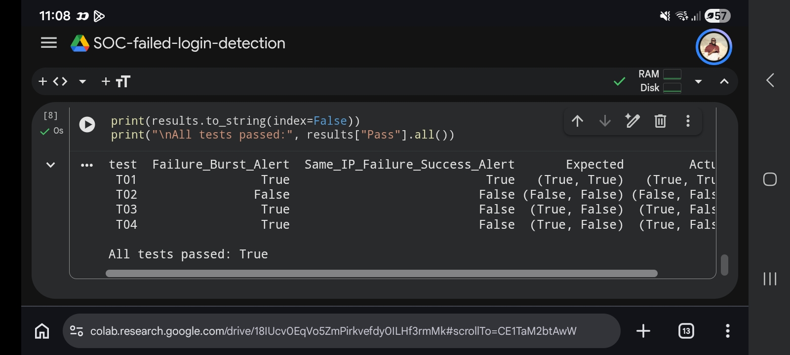

Windows Failed Login Investigation

Project Overview

This project demonstrates a basic Security Operations Centre (SOC) investigation into suspicious Windows authentication activity. It uses synthetic security events to identify repeated failed logins and investigate whether a successful login follows a burst of failures from the same source IP address.

The project simulates part of a Tier 1 SOC analyst workflow: identifying suspicious activity, validating detection logic, documenting findings, and recommending follow-up investigation.

Investigation Scenario

The sample dataset contains Windows authentication events:

- Event ID 4625: Failed logon
- Event ID 4624: Successful logon

The primary scenario contains repeated failed login attempts against an account, followed by a successful login from the same IP address. This pattern may indicate password guessing or brute-force activity, but it does not independently prove account compromise.

All event data is synthetic. The IP addresses are reserved for documentation and examples; they do not identify real attackers.

Detection Logic

The project includes draft KQL queries intended for Microsoft Sentinel:

- "detections/brute-force.kql" — identifies IP addresses associated with repeated failed logins.
- "detections/failures-followed-by-success.kql" — correlates failed and successful logins from the same IP within a defined time window.

Python was used in Google Colab to validate the prototype detection behavior against synthetic test scenarios.

Validation Results

4 of 4 test scenarios passed.

Scenario| Expected outcome| Result
Repeated failures followed by same-IP success| Both alerts trigger| PASS
Small number of failures| No alert| PASS
Repeated failures without success| Failure-burst alert only| PASS
Failures and success from different IPs| No same-IP correlation alert| PASS

Detailed results: ""test-results/detection-test-matrix.md"" (test-results/detection-test-matrix.md)

Investigation and Documentation

- ""incident-report.md"" (incident-report.md) — investigation findings and recommended response.
- ""sample-logs.csv"" (sample-logs.csv) — synthetic Windows authentication events.
- ""detections/"" (detections/) — draft KQL detection queries.
- ""test-results/"" (test-results/) — validation reports and test evidence.

Skills Demonstrated

- Windows authentication event analysis
- Failed-login and successful-login correlation
- Basic detection engineering
- KQL query development
- Python-based testing
- False-positive awareness
- Incident documentation and investigation
- Security alert triage and follow-up recommendations

Limitations and Next Steps

The Python prototype has been tested against the documented synthetic scenarios. The KQL queries have not yet been validated in a live Microsoft Sentinel workspace.

Future improvements include testing the KQL against representative Sentinel data, refining time-window logic, investigating additional event fields, and documenting alert tuning to reduce false positives.

Disclaimer

This is a learning project using synthetic data. It does not represent a live security incident, a production-ready detection, or proof of a real account compromise.

## Test Execution Evidence

The Python detection prototype was tested against four synthetic scenarios. All four passed.

See the [detection test matrix](test-results/detection-test-matrix.md) for the expected and observed outcomes.

Analyst Workflow Demonstrated

1. Detect: Identify repeated failed Windows authentication attempts.
2. Correlate: Check whether a successful login follows repeated failures from the same source IP.
3. Validate: Test expected alert behavior against four synthetic scenarios.
4. Document: Record evidence, findings, limitations, and recommended investigative actions.
5. Improve: Refine detection logic and identify areas requiring further validation.

Project Status

- [x] Synthetic Windows authentication dataset created
- [x] Incident report documented
- [x] Draft KQL detection queries written
- [x] Python prototype tested against four scenarios
- [x] Test results documented and screenshot published
- [ ] KQL validated in a Microsoft Sentinel workspace
- [ ] Additional testing against varied event patterns

Note: Passing Python tests do not establish that the KQL queries work correctly in a live Sentinel workspace. That validation remains outstanding.
